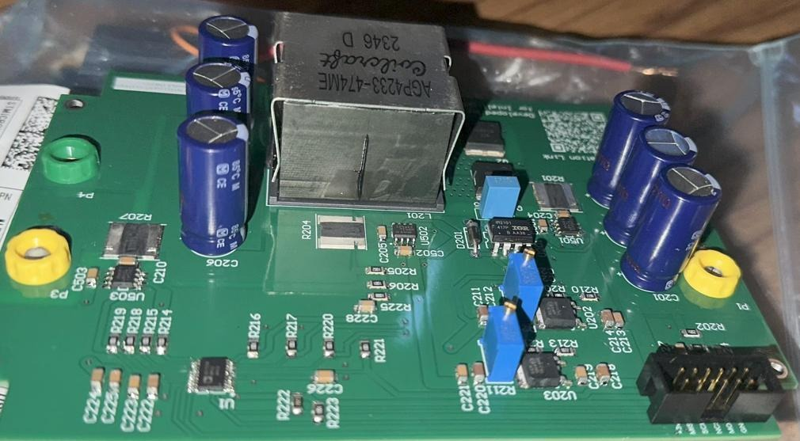
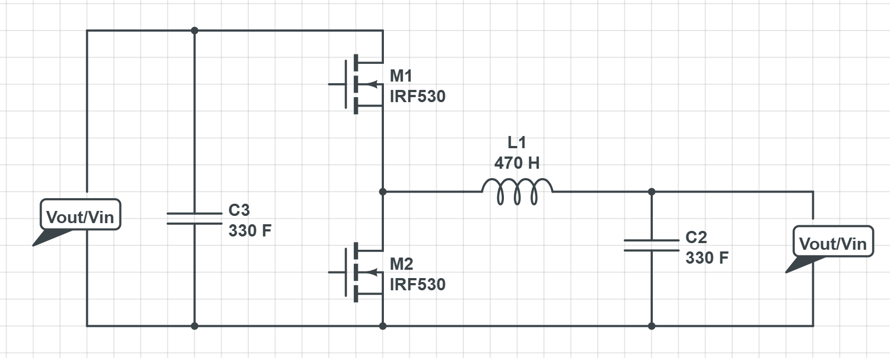
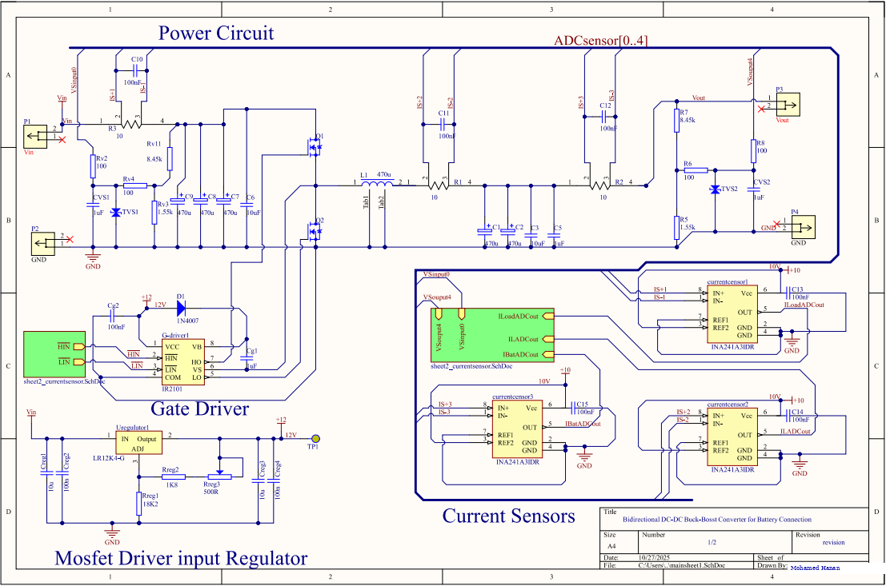
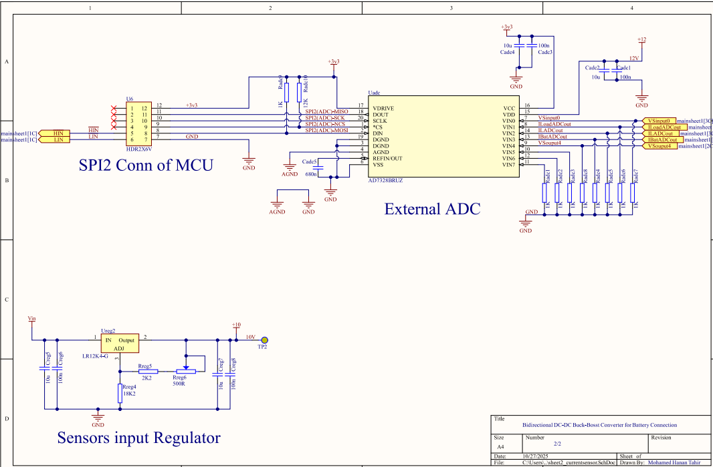
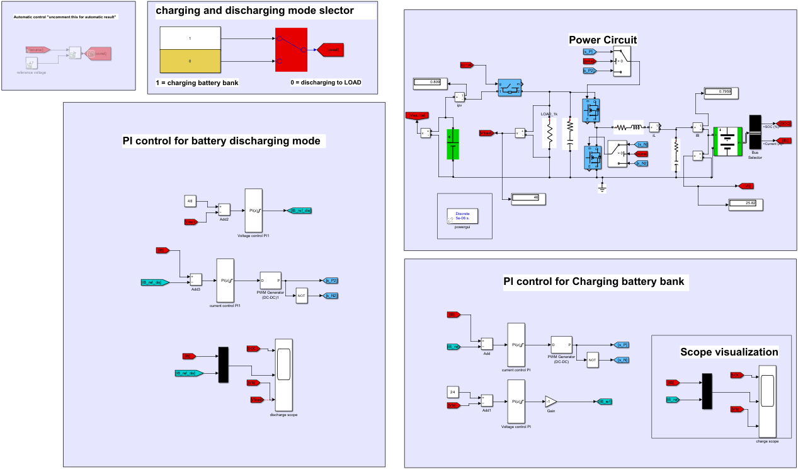
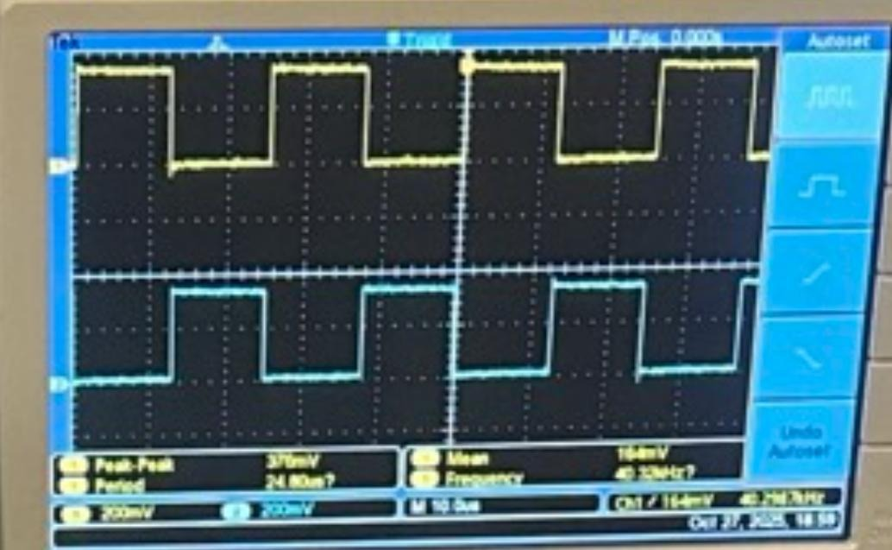
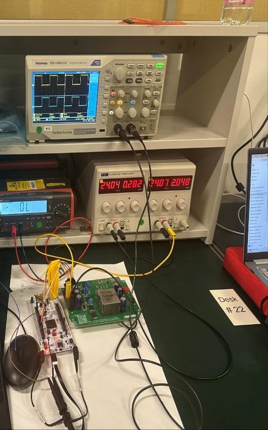

# Bidirectional DC-DC Buck-Boost Converter for Battery Connection

A 200 W, microcontroller-controlled synchronous half-bridge converter that moves energy **both ways** between a 48 V DC bus and a 24 V battery bank — stepping down to charge the battery, stepping up to discharge it back onto the bus.

The converter decides its own direction. An STM32H755 reads bus voltage, battery voltage and three current channels through an external 12-bit ADC, runs a cascaded CC–CV PI loop, and sets the duty cycle of a complementary PWM pair driving the half-bridge. Live telemetry streams to a host PC over UART.

<p align="center">
  
</p>

---

## Specification

| | |
|---|---|
| **Topology** | Synchronous half-bridge, non-isolated, bidirectional buck-boost |
| **Bus side** | 48 V DC (solar array / DC microgrid) |
| **Battery side** | 24 V nominal (7S Li-ion), ±2 % regulation |
| **Rated power** | 200 W, ~3.5 A continuous |
| **Switching frequency** | 40 kHz, centre-aligned, hardware dead-time |
| **Duty cycle** | ≥ 50 % buck (charge) · ≤ 50 % boost (discharge) |
| **Control** | Cascaded PI — outer voltage loop, inner current loop (CC–CV) |
| **Sensing** | 2 × resistive-divider voltage, 3 × shunt + INA241A3 current |
| **Data path** | AD7328 external 12-bit ADC → SPI → MCU → UART → host |
| **Controller** | STM32H755ZI-Q Nucleo-144 (dual-core M7 + M4) |

---

## How it works

<p align="center">
  
</p>

One inductor, two MOSFETs and a capacitor on each side. Which switch carries the PWM decides which way the energy flows:

**Charging (buck).** `Q1` (high side) is modulated and `Q2` freewheels. Current ramps into `L1` while `Q1` conducts and decays through `Q2` when it doesn't, so the battery sees a stepped-down average of the 48 V bus.

**Discharging (boost).** The roles swap. `Q2` is modulated, storing energy in `L1` from the battery, and releasing it through `Q1` into the 48 V bus at a higher voltage.

Because both switches are active MOSFETs rather than a diode, the same hardware runs in both directions — only the firmware's choice of modulated switch changes.

### CC–CV charge control

Charging a lithium pack needs two phases, and a single loop can't deliver both. The firmware uses a cascaded pair:

```
Vbat ─▶[ outer PI ]─▶ Iref ─▶[ inner PI ]─▶ duty ─▶ PWM
  ▲                            ▲                     │
  │                            └─ current feedback ──┤
  └─────────── voltage feedback ─────────────────────┘
```

While the pack is depleted, the outer loop saturates its current reference at the limit, so the inner loop holds a steady charge current — **constant current**. As the terminal voltage approaches the 24 V setpoint, the outer loop walks the current reference down and the system slides into **constant voltage**, with current tapering to the cutoff. The handover needs no mode-switching logic; it falls out of the loop structure.

---

## Hardware

<p align="center">
  
</p>

**Power stage.** Two `MCTL80N20Y-TP` 200 V / 80 A MOSFETs in TOLL-8L, an `IR2101` half-bridge driver with bootstrap supply, a 470 µH through-hole inductor, and ~990 µF of bulk electrolytic on each side. TVS diodes clamp both terminals.

**Sensing.** Three Kelvin-connected shunts feed `INA241A3` current-sense amplifiers; two resistive dividers scale bus and battery voltage. Both are scaled to the ADC's 0–10 V span so every channel shares one calibration.

The divider is sized for a 60 V ceiling rather than 48 V, so switching spikes don't clip the input:

$$V_{\text{ADC}} = 60 \times \frac{1.55\,\text{k}}{8.45\,\text{k} + 1.55\,\text{k}} = 9.3\ \text{V}$$

**Auxiliary supply.** An `LR12K4-G` wide-input linear regulator derives the 10–15 V driver and sensor rails directly from the 48 V bus — about 1.1 W dissipated at 30 mA, handled with a DPAK and copper pour. Linear rather than switching, deliberately: the analog front end sits on these rails.

<p align="center">
  
</p>

Full schematic: [`hardware/schematic.pdf`](hardware/schematic.pdf) · Bill of materials: [`hardware/bom.csv`](hardware/bom.csv)

---

## Firmware

Three peripherals carry the system, all on the M7 core:

- **TIM1 CH2/CH2N** — centre-aligned complementary PWM at 40 kHz with hardware dead-time insertion, so shoot-through protection never depends on software timing.
- **SPI1** — 16-bit master to the AD7328. Write order at init matters: control register *before* the range registers, or the part silently keeps its default ±10 V bipolar span.
- **USART3** — 115200-8-N-1 through the Nucleo's on-board ST-LINK virtual COM port. No external USB-serial adapter needed.

A span-loss check on channel 0 catches ADC brown-outs and re-initialises the part automatically rather than streaming garbage.

Source: [`firmware/Core/Src/main.c`](firmware/Core/Src/main.c) · Build and peripheral notes: [`firmware/README.md`](firmware/README.md)

---

## Simulation

The control strategy was validated in MATLAB/Simulink before any power touched the board — power stage, both PI loops, and a mode selector that switches between charging the pack and discharging into a load.

<p align="center">
  
</p>

---

## Results

<table>
<tr>
<td width="50%"></td>
<td width="50%"></td>
</tr>
<tr>
<td align="center"><em>Complementary gate drive, 40.3 kHz measured</em></td>
<td align="center"><em>Converter under test at 24 V</em></td>
</tr>
</table>

**What worked**

- Complementary PWM at 40 kHz with clean dead-time separation, measured on both gate signals.
- Step-down to 24 V and step-up to 48 V, both verified on the bench.
- End-to-end telemetry: AD7328 → SPI → MCU → UART → host terminal.
- Full CC–CV charge and discharge cycles in simulation, matching the design targets.

**What didn't**

- Closed-loop charging of a real battery was never reached. The low-side MOSFET failed twice, and some ADC frames came back corrupted.

The failure analysis is worth reading in full — it's the most useful part of the project. See [`docs/results.md`](docs/results.md).

---

## Design calculations

Every component value in the BOM is backed by a derivation rather than a rule of thumb — switching frequency from the inductor ripple budget, capacitor sizing from sag/soar during load steps, loss and efficiency estimates, and the duty-to-output transfer functions for both modes.

| Quantity | Buck (charge) | Boost (discharge) |
|---|---|---|
| Duty cycle | 0.5007 | 0.500 |
| Minimum f<sub>sw</sub> | 36.5 kHz | 36.4 kHz |
| Inductor ripple Δi<sub>L</sub> | 0.7 A (20 %) | 0.7 A (10 %) |
| Output ripple ΔV | 22 mV | 44 mV |
| Switching loss | 319 mW | 638 mW |
| Inductor loss | 142 mW | 81 mW |
| Estimated efficiency | ~99.5 % | ~99.5 % |

Full working: [`docs/design-calculations.md`](docs/design-calculations.md)

---

## Repository layout

```
├── hardware/
│   ├── schematic.pdf          Full schematic, both sheets
│   └── bom.csv                Bill of materials
├── firmware/
│   ├── Core/Src/main.c        PWM, SPI/AD7328 driver, UART telemetry
│   └── README.md              Build and peripheral configuration notes
├── docs/
│   ├── design-calculations.md Derivations, component sizing, transfer functions
│   └── results.md             Bench results and MOSFET failure analysis
└── images/                    Schematics, board photos, scope captures
```

---

## Further work

The path to a working closed-loop charger is clear, and the limits are instrumentation and gate-drive robustness rather than anything structural:

1. **Gate drive** — tune dead time rather than simply lengthening it, add a Miller clamp and stronger pull-downs, and size gate resistors for controlled dV/dt. Verify with double-pulse testing.
2. **Switch-node ringing** — an RC snubber and a low-Q<sub>rr</sub> device or parallel Schottky across the low side.
3. **Protection** — cycle-by-cycle current limit, soft-start and pre-charge, over-temperature derating.
4. **Measurement integrity** — tighter ADC reference decoupling, separated analog and digital grounds, DMA-driven SPI with guard times, and framing/CRC on the UART link.
5. **Loop bring-up** — calibrate the inner current loop at low power first, close the outer voltage loop second, and document step responses before a battery is ever connected.

---

## License

[Apache-2.0](LICENSE)
