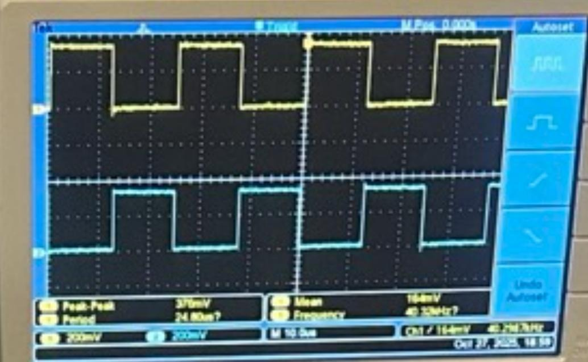
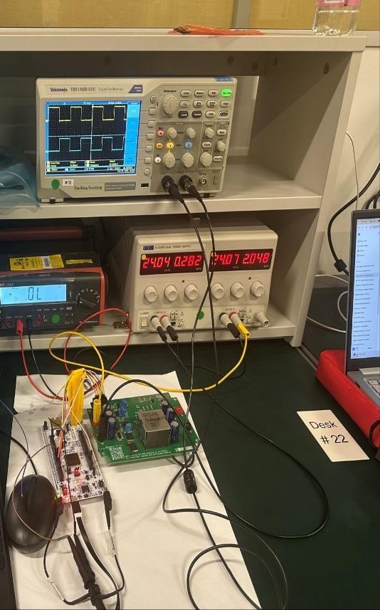
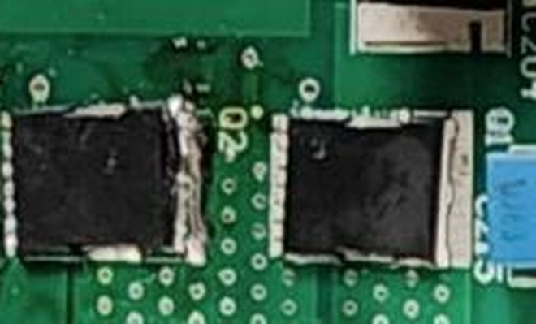

# Results and Failure Analysis

What the converter actually did on the bench, what broke, and why.

---

## 1. Verified on hardware

### Complementary PWM with dead time

TIM1 CH2/CH2N produced a complementary gate-drive pair at a measured **40.3 kHz**, with clean non-overlap between the two signals. Dead time is inserted by the timer's hardware break/dead-time unit, not by software, so the non-overlap guarantee does not depend on interrupt latency or loop timing.

### Bidirectional voltage conversion

Both directions were demonstrated:

- **Step-down** to 24 V with duty cycle ≥ 50 %
- **Step-up** to 48 V with duty cycle ≤ 50 %

### Telemetry chain

The full measurement path worked end to end: AD7328 sampled the sensor channels, the MCU read them over SPI, and the readings were streamed over UART to a host terminal (RealTerm) at 115200 baud. Some frames arrived corrupted — see §3.

### Simulation

Complete CC–CV charge and discharge cycles ran in MATLAB/Simulink, with both PI loops closed and a mode selector switching between charging the pack and discharging into a load. The simulated behaviour matched the design targets, which is what makes the hardware shortfall a reliability problem rather than a design one.

---

## 2. Low-side MOSFET failure

The headline result is a negative one: **the low-side MOSFET failed twice**, which ended any prospect of closed-loop charging at full power.

### Sequence

1. First failure occurred with dead time set to **100 ns**.
2. The device was replaced and dead time increased to **200 ns**.
3. The replacement failed as well.
4. The second failure damaged the copper plating under the device, so no further replacement was possible.

### Why lengthening dead time didn't help

The instinct after a shoot-through failure is to add dead time. That instinct is wrong here, and the second failure is the evidence. Dead time has a penalty at *both* ends:

**Too little** — both MOSFETs conduct simultaneously for part of the transition and the half-bridge shorts the bus through both devices. Classic shoot-through.

**Too much** — the low-side body diode is forced to carry inductor current during the gap. Body diodes in power MOSFETs are slow, with substantial stored charge. When the high side turns on, that charge must be swept out, and the resulting reverse-recovery current spike flows through the low-side device. The longer the diode conducts, the more charge accumulates, and the harder the recovery pulse.

So dead time has an optimum, not a floor. Going from 100 ns to 200 ns likely moved the failure mechanism from shoot-through to reverse recovery without ever passing through a safe window — the device died either way, for opposite reasons.

### Other contributing mechanisms

Several effects plausibly compounded the problem, and none can be ruled out without instrumented gate measurements:

**Miller turn-on.** A fast dV/dt at the switch node couples through the MOSFET's gate-drain (Miller) capacitance and can momentarily pull the low-side gate above threshold even when the driver is commanding it off. The result is a brief overlap that no amount of dead time prevents, because the device is turning itself on. A Miller clamp or a strong gate pull-down is the fix, not more dead time.

**Gate-drive weakness.** Insufficient sink current, driver supply droop, high common-source inductance, or a poorly referenced gate return all slow turn-off and widen the window in which both devices conduct.

**Layout parasitics.** A large high-di/dt loop area and inadequate local decoupling produce VDS and VGS overshoot and ringing. Repetitive avalanche from that ringing degrades the device over many cycles before it finally fails.

**Thermal and SOA margin.** The loss estimates in [`design-calculations.md`](design-calculations.md) deliberately omit conduction, gate-drive and diode-conduction losses. Real dissipation is higher than the ~99.5 % figure suggests, and with constrained copper area and no heatsinking the junction may have been running far closer to its limit than the headline number implies.

**Inductor saturation.** The 470 µH part was already undersized for the originally intended current. During transients, saturation would collapse the inductance and let current rise far faster than the design assumes.

**Start-up transients.** Unusual duty cycles or on-times during start-up, before the control loop settles, can stress the switches outside the steady-state operating point entirely.

### Remedies

| Mechanism | Remedy |
|---|---|
| Shoot-through / reverse recovery | **Optimise** dead time by measurement, don't maximise it; verify by double-pulse test |
| Miller turn-on | Miller clamp or strong gate pull-down; gate resistor sized for controlled dV/dt |
| Reverse recovery | Low-Qrr device, or a Schottky in parallel with the low-side switch |
| Ringing / overshoot | Reduce loop inductance, tight ceramic VIN decoupling, RC snubber |
| Thermal / SOA | Re-check SOA at the real duty and ripple; increase copper area |
| Transient stress | Cycle-by-cycle current limit, soft-start, over-temperature derating |

---

## 3. ADC data corruption

Some SPI frames from the AD7328 arrived corrupted. The cause was not isolated before the project ended. The likely candidates:

- **Reference and supply integrity** — the ADC reference and VDD decoupling sit on rails derived from the switching power stage. Insufficient decoupling lets switching noise modulate the conversion.
- **Grounding** — analog and digital grounds sharing return paths lets digital switching currents appear as analog offset.
- **SPI timing** — CPOL/CPHA mode and chip-select setup/hold margins against the datasheet, particularly at the inter-frame boundary where the AD7328 latches on the rising CS edge.
- **No error detection** — the firmware has no framing or CRC on the UART link, so a corrupted frame is indistinguishable from a valid one downstream.

The firmware does carry one defence: a span-loss check on channel 0 that detects when the ADC has reverted to its default range after a brown-out and re-initialises it automatically. That catches configuration loss but not bit-level corruption.

**Recommended:** tighter reference decoupling, separated analog/digital ground planes, DMA-driven SPI with explicit guard times, and framing plus CRC on the UART protocol.

---

## 4. Assessment

The electrical design, control strategy and measurement architecture all hold up. Both conversion directions were demonstrated, the telemetry path worked end to end, and the control strategy was validated in simulation.

What stopped the project short of a working battery charger was reliability at the switching edges and noise in the instrumentation — both well-understood problems with well-understood fixes, and both addressable without redesigning the converter.

### Recommended bring-up order

Approach loop closure carefully on hardware, in this order:

1. Verify gate-drive waveforms by double-pulse test before applying any load.
2. Calibrate and close the **inner current loop** at reduced power.
3. Document the step response; confirm bandwidth and phase margin.
4. Close the **outer voltage loop**.
5. Re-document the step response.
6. Only then connect a battery.

A battery is an energy source that will not current-limit for you. It belongs at the end of the sequence, not the start.
